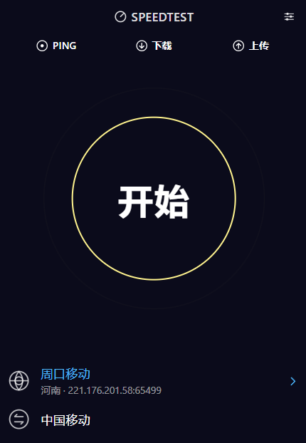
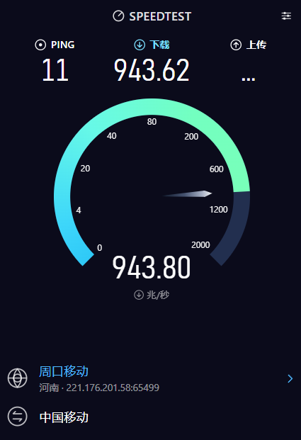
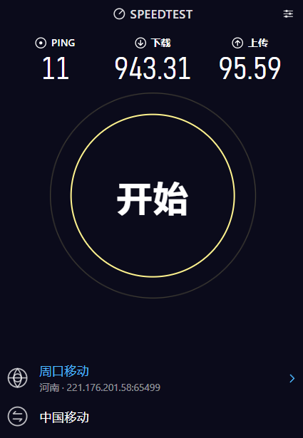

# TaierSpeedTest

一个面向 Windows 的网速测试客户端，基于对泰尔网速测试（cnspeedtest）公开 Android 客户端行为的分析独立实现。

泰尔的网速测试服务本身是免费的，本项目并不是对任何付费内容的绕过，也不是官方产品的替代或再分发。

## 免责声明

- 本项目是**第三方、非官方**客户端，与泰尔（cnspeedtest）及其关联机构**没有任何隶属或合作关系**。
- 原始服务、节点基础设施、品牌与商标均归其各自所有者所有。本项目不主张对上述任何内容的权利。
- 项目代码是在对公开客户端**行为进行分析**的基础上独立编写的实现。
- 仅供个人学习、研究与自用测试。请优先使用官方客户端；如官方提供 Windows 版本，建议更换使用。
- 使用本软件即表示你自行承担相关风险，包括但不限于服务条款、当地法律法规以及网络环境的差异。
- 若权利方对本项目存在异议，请通过下方联系方式告知，作者将**在收到通知后立即删除相关内容**。

## 界面预览

<table>
  <tr>
    <td align="center"></td>
    <td align="center"></td>
    <td align="center"></td>
  </tr>
  <tr>
    <td align="center">待机 · 选择节点</td>
    <td align="center">下载测速中</td>
    <td align="center">测速完成</td>
  </tr>
</table>

## 功能

- **延迟测试**（Ping）：ICMP 多轮探测，实时显示单次与平均延迟
- **下载测速**：4 线程并发，分段采样取平均，带预热阶段
- **上传测速**：4 线程并发上传，分段采样取平均
- **完整测速**：延迟 → 下载 → 上传 顺序执行
- **单项模式**：菜单中可单独执行「仅测延迟 / 仅测下载 / 仅测上传」
- **节点选择**：按省份 / 运营商筛选节点，支持节点列表刷新
- **记忆上次节点**：配置本地持久化，下次启动自动恢复
- **仪表盘 UI**：指针式仪表、实时速率曲线动画

## 技术栈

| 层 | 技术 |
|---|---|
| 桌面框架 | Tauri 2 |
| 后端 | Rust（`std::net` 原生 TCP / Windows ICMP API） |
| 前端 | 原生 HTML / CSS / JavaScript（无框架） |
| 图表 | Canvas 手绘仪表盘 |

## 目录结构

```
.
├── build.bat                # Windows 构建脚本
├── src/                     # 前端（HTML/CSS/JS）
│   ├── index.html
│   ├── style.css
│   └── app.js
└── src-tauri/
    ├── Cargo.toml
    ├── tauri.conf.json      # 应用配置
    └── src/
        ├── main.rs          # Tauri 入口、命令注册、测速流程编排
        ├── net.rs           # 节点获取、HTTP 请求、延迟测量
        └── speed.rs         # 下载/上传吞吐测量
```

## 许可

本项目代码以 [MIT 许可证](LICENSE) 授权，版权归 **muchen** 所有。

MIT 授权仅覆盖本仓库中的源代码本身，不覆盖泰尔网速测试的服务、节点数据、品牌商标或任何第三方内容。

## 联系

如您认为本项目侵犯了您的合法权益，请联系作者，我们会尽快处理并在确认后删除相关内容。

- 作者：muchen
